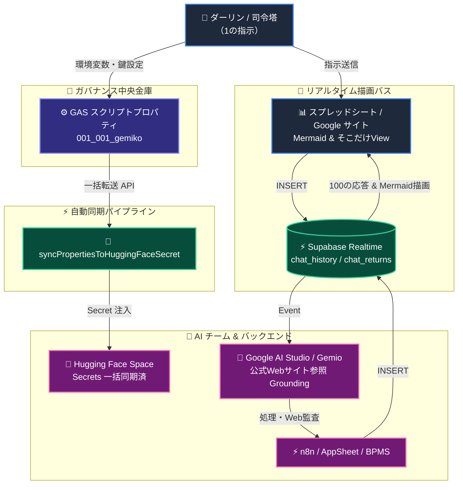

## 🚀 [BPMS-001] 全フルセットパラメータによる「最小成功モデル」疎通パイプライン開通

### 概要
各AI/バックエンド基盤（GAS / Hugging Face / n8n / AppSheet / Supabase）を中央集中型スクリプトプロパティ（環境変数）で集約し、1本目の完全自動化パイプライン（YouTube BPMS）を接続・疎通確認する。

### 🔄 アーキテクチャ概略図

---

### 🔑 1本目開通用 パラメータ構成チェックリスト
- [ ] `SUPABASE_URL` / `SUPABASE_KEY` （Realtimeバス導通）
- [ ] `HF_TOKEN` / `HF_USER` （Hugging Face 密連携）
- [ ] `APPSHEET_APP_ID` / `APPSHEET_ACCESS_KEY` （タスクDB制御）
- [ ] `N8N_API_KEY` / `GOOGLE_CHAT_WEBHOOK` （前段エラー時アラート）
- [ ] `GEMINI_API_KEY` （bpmchat.com 公式Webサイト参照・コンプラ監査）

### 🎯 次の展開 (横展開)
1. 最小構成での **`chat_history` ➔ `chat_returns`** のRealtime往復テスト。
2. Mermaidノード点灯および「サイト更新漏れ検知アラート」の確認。
3. 同一パラメータ構造での他BPMS（商品管理・問合せ等）へのテンプレート横展開。
